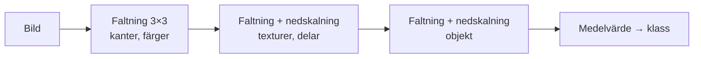
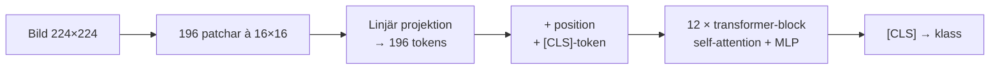

# Vision Transformers (ViT) och CNN: underlag för presentationen

Faktaunderlag för en presentation på cirka 45 minuter. Tidsplan, demomanus och svar på vanliga
frågor finns i [presentation-plan.md](presentation-plan.md). Användningsområden med länkar och
frågan om ViT är state of the art finns i [vit-in-practice.md](vit-in-practice.md).

**Kort version:** En CNN letar efter lokala mönster i bilden med små filter och bygger upp
helheten lager för lager. En ViT delar upp bilden i rutor och låter alla rutor "titta på"
varandra med self-attention, så den ser helheten redan från första lagret. CNN:en har mer
inbyggd kunskap om bilder och klarar sig med mindre data. ViT:en måste lära sig mer från data,
men är lättare att skala upp och är grunden i nästan alla stora bildmodeller i dag.

## 1. Transformers

**Bakgrund.** Transformern presenterades 2017 av Google i artikeln
[Attention Is All You Need](https://arxiv.org/abs/1706.03762), först för maskinöversättning.
Tidigare språkmodeller (RNN och LSTM) läste texten ett ord i taget. Det gick långsamt och de
tappade bort samband mellan ord som stod långt ifrån varandra.

**Så fungerar den, steg för steg:**

1. **Tokens.** Texten delas upp i tokens, ungefär ord eller orddelar.
2. **Embedding.** Varje token görs om till en vektor, till exempel 768 tal. En
   positionskodning läggs till så att modellen vet i vilken ordning orden kom.
3. **Self-attention.** Varje token räknar fram tre vektorer: en *query* (vad letar jag efter?),
   en *key* (vad innehåller jag?) och ett *value* (vad har jag att förmedla?). Hur väl en tokens
   query matchar alla andras keys avgör hur mycket den "lyssnar" på dem. Resultatet är ett viktat
   medelvärde av de andras values: `softmax(Q·Kᵀ / √d) · V`.
4. **MLP och residualkopplingar.** Efter attention bearbetas varje token var för sig i ett litet
   nätverk. Blocket upprepas många gånger, från 12 lager i små modeller till över 100 i stora.

**Exempel att visa:** I meningen *"Djuret gick inte över gatan eftersom det var för trött"*
får ordet *det* hög attention mot *djuret*. Byt *trött* mot *bred*, så pekar *det* i stället
mot *gatan*. Samma ord får olika betydelse beroende på sammanhanget.

**Multi-head attention.** Flera attention-"huvuden" körs parallellt. Varje huvud kan lära sig
en egen typ av samband, till exempel grammatik i ett huvud och vem "det" syftar på i ett annat.

**Varför transformern tog över:**

- **Parallell.** Alla tokens behandlas samtidigt, vilket passar grafikkort perfekt.
- **Långa samband.** Varje token når alla andra direkt, inte via en lång kedja.
- **Skalar förutsägbart.** Mer data och större modeller ger jämnt bättre resultat.
- **Generell.** Samma byggsten används för text, bild, ljud, video och proteiner.

**Tre varianter:** *Encoder* (BERT, ViT) läser hela indata på en gång och används för att förstå.
*Decoder* (GPT, Llama) genererar en token i taget. *Encoder–decoder* är originalet för översättning.

**Baksidan:** Attention jämför alla par av tokens. Dubbelt så många tokens ger fyra gånger så
mycket attention-beräkning, alltså kvadratisk kostnad.

## 2. CNN (Convolutional Neural Network)

**Historia i fyra steg:**

- **1980.** Fukushimas *Neocognitron* bygger på hur synbarken tros fungera.
- **1989–1998.** Yann LeCuns *LeNet* läser handskrivna siffror, bland annat på checkar.
- **2012.** *AlexNet* vinner bildtävlingen ImageNet med 15,3 % fel bland topp 5, mot 26,2 % för
  tvåan. Det blir starten på deep learning-eran.
- **2015.** *ResNet* inför residualkopplingar som gör 152 lager möjliga och vinner ImageNet med
  3,57 % fel bland topp 5 ([artikel](https://arxiv.org/abs/1512.03385)).

**Så fungerar den:**

1. **Faltning (convolution).** Ett litet filter, oftast 3×3 pixlar, glider över bilden. På
   varje position mäter det hur väl området matchar filtrets mönster. Samma filter används
   överallt i bilden, så kallad viktdelning.
2. **Många filter per lager.** Varje filter ger en egen "karta" över var mönstret finns.
3. **Nedskalning.** Pooling eller steg (stride) krymper kartorna. Därför ser nästa lager ett
   större område av originalbilden, och det receptiva fältet växer med djupet.
4. **Hierarki.** Tidiga lager hittar kanter och färger, mellanlager texturer och delar som ögon
   och hjul, sena lager hela objekt.
5. **Klassificering.** Kartorna medelvärdesbildas och ett sista lager väljer klass.

**Inbyggda antaganden (inductive bias).** En CNN förutsätter att närliggande pixlar hör ihop
(lokalitet) och att ett mönster betyder samma sak var det än står i bilden (translations-
ekvivarians). Det är förkunskap om bilder som modellen inte behöver lära sig. Därför räcker
mindre data, men antagandena begränsar också vad modellen kan upptäcka.

**Kända CNN:er:** LeNet, AlexNet, VGG, ResNet, EfficientNet, MobileNet (mobiler), U-Net
(segmentering, inte minst i medicin), YOLO (objektdetektion i realtid) och ConvNeXt (2022, en
modern CNN som lånat designidéer från ViT, [artikel](https://arxiv.org/abs/2201.03545)).

## 3. Vision Transformer (ViT)

**Bakgrund.** Google presenterade ViT 2020 i artikeln
[An Image is Worth 16x16 Words](https://arxiv.org/abs/2010.11929). Idén var att använda en
vanlig transformer nästan helt oförändrad på bilder. Det enda nya är hur bilden blir tokens.

**Steg för steg, för modellen ViT-B/16 och en bild på 224×224 pixlar:**

1. **Dela upp bilden** i rutor (patchar) på 16×16 pixlar. Det blir 14×14 = 196 patchar.
2. **Gör varje patch till en token.** Patchen plattas till 16·16·3 = 768 tal och multipliceras
   med en inlärd matris. Det motsvarar ordens embedding i en språkmodell.
3. **Lägg till position.** Varje patch får en inlärd positionsvektor. Annars vet modellen inte
   var i bilden rutan satt.
4. **Lägg till en [CLS]-token**, en idé lånad från BERT. Den innehåller ingen bild men samlar
   information från alla patchar. Nu finns 197 tokens.
5. **Kör 12 transformer-lager** med self-attention. Varje patch kan titta på alla andra redan i
   första lagret.
6. **Klassificera** utifrån [CLS]-tokenens slutvektor. Hela modellen har 86 miljoner parametrar.

**Det överraskande resultatet.** Tränad på bara ImageNet (1,3 miljoner bilder) blev ViT några
procentenheter *sämre* än lika stora ResNet. Förtränad på Googles interna JFT-300M (300
miljoner bilder) slog den i stället de bästa CNN:erna. ViT-H/14 nådde 88,55 % på ImageNet, mot
87,54 % för BiT-L och 88,4 % för Noisy Student. Förträningen krävde 2 500 TPUv3-kärndygn, mot
9 900 respektive 12 300 för de två CNN:erna, alltså en fjärdedel till en femtedel. Lärdomen: det
som saknas i inbyggda antaganden kan ersättas med data.

**Vad ViT lär sig själv.** Positionsvektorerna lär sig rutnätets 2D-struktur, så närliggande
patchar får liknande vektorer. Redan i de första lagren tittar vissa attention-huvuden lokalt,
ungefär som en CNN, medan andra tittar över hela bilden.

**Viktiga uppföljare:**

| År | Modell | Bidrag |
|---|---|---|
| 2020 | [DeiT](https://arxiv.org/abs/2012.12877) (Meta) | ViT tränad på bara ImageNet med kraftig dataaugmentering, på en dator med 8 GPU:er på under tre dygn |
| 2021 | [Swin Transformer](https://arxiv.org/abs/2103.14030) (Microsoft) | Attention i lokala fönster och hierarkiska nivåer som i en CNN. Bra för detektion och segmentering |
| 2021 | [CLIP](https://arxiv.org/abs/2103.00020) (OpenAI) | Bild och text tränas ihop på 400 miljoner par. Ger sökning och klassificering utan träningsexempel |
| 2021 | [MAE](https://arxiv.org/abs/2111.06377) (Meta) | Självövervakad förträning: dölj 75 % av patcharna och låt modellen återskapa dem |
| 2023 | [Segment Anything](https://arxiv.org/abs/2304.02643) (Meta) | ViT-kodare som segmenterar vad som helst. Tränad på 1,1 miljarder masker |
| 2023 | [ViT-22B](https://arxiv.org/abs/2302.05442) (Google) | 22 miljarder parametrar och den mest människolika formbias som uppmätts |
| 2023 | [Registers](https://arxiv.org/abs/2309.16588) (Meta) | Extra tokens som tar bort störande artefakter i attention-kartorna |
| 2025 | [DINOv3](https://arxiv.org/abs/2508.10104) (Meta) | 7 miljarder parametrar, självövervakad på 1,7 miljarder bilder |

**Hybrider och släktingar.** [CoAtNet](https://arxiv.org/abs/2106.04803) (Google) blandar
faltning och attention. MobileViT och FastViT (Apple) är hybrider för mobiler. Swin är en
transformer med CNN-lik struktur. ConvNeXt är tvärtom en ren CNN som lånat idéer från ViT.

## 4. Skillnader

| | CNN | ViT |
|---|---|---|
| Grundoperation | Faltning: ett litet filter med samma vikter överallt | Self-attention: vikterna räknas fram från innehållet, mellan alla patchar |
| Synfält | Lokalt, växer lager för lager | Globalt från första lagret |
| Inbyggda antaganden | Starka: lokalitet och translationsekvivarians | Svaga: rumslig struktur måste läras från data |
| Data för att träna från grunden | Måttligt | Mycket, eller kraftig augmentering, eller förträning |
| Skalning | Skalar också ([DeepMind 2023](https://arxiv.org/abs/2310.16764)), men de största modellerna byggs sällan som CNN | Mycket enkel att skala, standard i stora förtränade modeller |
| Beräkningskostnad | Växer linjärt med antal pixlar | Växer kvadratiskt med antal patchar |
| Mobil och inbyggda system | Mycket väloptimerad | Tyngre, men allt bättre stöd |
| Text och bild tillsammans | Möjligt men ovanligt | Standard, eftersom bilden blir tokens precis som text |
| Robusthet i demon | Klassisk CNN (ResNet-50) är känslig för brus och oskärpa. Modern CNN (ConvNeXt) tål brus lika bra som ViT | Tål brus och oskärpa bättre än ResNet-50, men är känslig för störningar som inte följer patchrutnätet |
| Förklaringar | Aktiveringskartor (Grad-CAM) | Attention-kartor, som kan innehålla artefakter |

## 5. För- och nackdelar

### CNN

**Fördelar**

- **Lär sig från lite data** tack vare de inbyggda antagandena. Med 20 epoker på CIFAR-10 från
  grunden når CNN:en i det här repot 90,3 % mot ViT:ens 77,3 %
  ([experiment.md](experiment.md#sample-results)).
- **Effektiv.** Kostnaden växer linjärt med bildstorleken och den är mycket väloptimerad för
  mobiler, kameror och inbyggda system.
- **Mogen teknik** med många färdiga modeller, verktyg och erfarenheter.

**Nackdelar**

- **Ser lokalt.** Samband över hela bilden kräver många lager.
- **Gissar gärna på textur.** ImageNet-tränade CNN:er avgör mest utifrån yta och textur, medan
  människor går på form ([Geirhos m.fl. 2019](https://arxiv.org/abs/1811.12231)).
- **Klassiska CNN:er är känsligare för brus.** I demon faller ResNet-50 betydligt snabbare än
  ViT när bilden blir brusig eller suddig. En modern CNN som ConvNeXt tål däremot brus lika bra
  som ViT.
- **Sällan grunden** i dagens stora förtränade bild- och multimodala modeller.

### ViT

**Fördelar**

- **Global kontext** från första lagret.
- **Skalar mycket bra** med data och modellstorlek, upp till miljarder parametrar.
- **Samma arkitektur som språkmodeller.** Det gör det enkelt att kombinera bild och text, som i
  CLIP och i chattbottar som kan se.
- **Självövervakad förträning fungerar mycket bra** (MAE, DINO). Man kan träna på enorma mängder
  bilder utan etiketter.
- **Mer robust mot brus och oskärpa än en klassisk CNN** i demon, och mot oskärpa även bättre än
  ConvNeXt. Det stöds av forskning som jämför rättvist tränade modeller
  ([Bai m.fl. 2021](https://arxiv.org/abs/2111.05464)).

**Nackdelar**

- **Datahungrig.** Från grunden på lite data förlorar ViT tydligt mot CNN.
- **Dyr vid hög upplösning.** Dubbelt så hög upplösning ger fyra gånger så många patchar och
  ungefär sexton gånger så mycket attention-beräkning. Swin, hierarkiska modeller och
  effektivare attention minskar problemet.
- **Patchrutnätet är en svaghet.** I demon tål ViT svarta rutor som följer dess 16×16-rutnät,
  men faller kraftigt om samma rutor flyttas 8 pixlar.
- **Tyngre att köra** på små enheter, och mer känslig för träningsinställningar som
  uppvärmning av inlärningstakten och dataaugmentering.
- **Attention-kartor är ingen garanterad förklaring.** De kan innehålla artefakter
  ([Registers](https://arxiv.org/abs/2309.16588)).

## 6. När ska man använda vilken?

En tumregel först: **valet av förtränad modell och data spelar oftast större roll än
arkitekturen.**

| Situation | Rekommendation |
|---|---|
| Liten datamängd och ingen förtränad modell | CNN, men försök först hitta en förtränad modell att finjustera |
| Det finns en förtränad stor modell för området, t.ex. DINOv2/v3, CLIP/SigLIP, SAM eller UNI | Använd den, oftast en ViT. Finjustera eller träna bara ett litet lager ovanpå |
| Mobil, kamera eller mikrokontroller med hårda krav på svarstid | CNN (MobileNet, EfficientNet, YOLO) eller en effektiv hybrid. Mät på målhårdvaran |
| Bild och text tillsammans: sökning, beskrivningar, frågor om bilder | ViT (CLIP, SigLIP) |
| Brusiga bilder: svagt ljus, enkla sensorer, medicinska bilder | ViT eller en modern CNN som ConvNeXt. Båda tålde brus bättre än ResNet i demon. Mät på din egen data |
| Objektdetektion i realtid | Båda: YOLO (CNN) för små enheter och CPU, RF-DETR (ViT) när noggrannhet är viktigast |
| Mycket högupplösta bilder: satellit, patologi | Hierarkiska transformers som Swin, ViT på utsnitt som slås ihop, eller CNN |

## 7. Demon: när vinner vilken?

Repot innehåller två experiment som tillsammans visar avvägningen. Detaljer och kommandon finns
i [robustness-demo.md](robustness-demo.md) och [experiment.md](experiment.md).

**Del 1: tränade från grunden på lite data vinner CNN.** Två små modeller med under 1 miljon
parametrar tränas likadant på CIFAR-10 (50 000 bilder). CNN:en når 90,3 % och ViT:en 77,3 %.

**Del 2: förtränade och lika stora modeller, där ViT tål störningar bättre.** ViT-S/16 (DeiT,
22 M parametrar) jämförs med ResNet-50 (26 M parametrar). Båda är tränade på samma 1,3
miljoner ImageNet-bilder med moderna träningsrecept och känner igen rena bilder lika bra. Testet
görs på 500 bilder ur ImageNets valideringsmängd som ingen av modellerna sett.

| Störning | ViT-S/16 | ResNet-50 |
|---|---|---|
| Ingen | 81 % | 81 % |
| Gaussiskt brus, σ = 0,3 | 62 % | 43 % |
| Salt-och-peppar-brus, 5 % av pixlarna | 73 % | 53 % |
| Oskärpa, σ = 4 pixlar | 44 % | 33 % |

Skillnaderna i tabellen är statistiskt säkerställda (McNemar-test, p < 0,001), utom på rena
bilder där modellerna är lika bra.

**Håller det i större skala?** Ja. På ImageNetV2, med 10 000 nya bilder i alla 1000 klasser,
klarar båda modellerna 68–69 % av de rena bilderna. Vid brusnivå 0,3 klarar ViT 39 % och
ResNet-50 26 % ([graf](images/noise-accuracy-imagenetv2.png)).

**Del 3, valfri: ViT på satellitbilder.** En förtränad ViT finjusteras på EuroSAT, 27 000
Sentinel-2-bilder från Copernicus i tio klasser som skog, åker, bostadsområde och vatten. Den
känner igen 99,0 % av bilderna den inte tränats på. Sedan hämtar den en färsk Sentinel-2-bild via
Sentinel Hub och klassar den ruta för ruta, 640 × 640 meter i taget. Detaljer i
[satellite-demo.md](satellite-demo.md).

**Varför tål ViT brus bättre?** Forskning visar att self-attention fungerar som ett
lågpassfilter, som jämnar ut snabba variationer mellan pixlar. Faltningslager fungerar
tvärtom som högpassfilter och förstärker dem
([Park & Kim 2022](https://arxiv.org/abs/2202.06709)). Brus består just av snabba variationer.

**Nyans att ta upp: ocklusion.** En känd artikel visar att ViT klarar att stora delar av
bilden täcks över ([Naseer m.fl. 2021](https://arxiv.org/abs/2105.10497)). Demon visar att det
beror på *hur* man täcker:

| Andel svarta rutor 16×16 px | ViT-S/16 | ResNet-50 |
|---|---|---|
| 50 %, rutor i linje med ViT:s rutnät | 72 % | 62 % |
| 50 %, samma rutor förskjutna 8 px | 48 % | 63 % |

När rutorna följer ViT:s patchar blir varje patch antingen hel eller helt svart, och ViT kan
bortse från de svarta. När rutorna förskjuts får varje patch skarpa svarta kanter som ViT inte
känner igen. Slutsats för publiken: robusthet är inte en egenskap som en arkitektur "har" eller
"inte har". Den beror på vilken typ av störning man mäter.

**Nyans 2: modern CNN och träningsrecept.** Samma test med sex modeller, alla tränade på bara
ImageNet. Siffrorna är andel rätt i procent.

| Modell | Typ | Parametrar | Ren bild | Brus σ 0,3 | Salt och peppar 10 % | Oskärpa σ 4 | Ocklusion 50 % i linje | Ocklusion 50 % förskjuten |
|---|---|---|---|---|---|---|---|---|
| ViT-S/16 (DeiT) | ViT | 22,1 M | 81 | 62 | 60 | 44 | 72 | 48 |
| ViT-B/16 (DeiT) | ViT | 86,6 M | 82 | 70 | 67 | 51 | 77 | 56 |
| Swin-T | Transformer med lokala fönster | 28,3 M | 81 | 53 | 72 | 37 | 75 | 76 |
| ConvNeXt-T | Modern CNN (2022) | 28,6 M | 83 | 67 | 75 | 39 | 62 | 64 |
| ResNet-50, modernt recept | Klassisk CNN | 25,6 M | 81 | 43 | 48 | 33 | 62 | 63 |
| ResNet-50, recept från 2015 | Klassisk CNN | 25,6 M | 80 | 7 | 17 | 29 | 2 | 1 |

- **Mot den klassiska CNN:en ResNet-50** vinner ViT på allt utom förskjuten ocklusion.
- **Den moderna CNN:en ConvNeXt** tål brus lika bra som ViT och salt-och-peppar-brus bättre.
  Den har lånat tre designval från ViT som gör CNN:er robusta: bilden delas in i 4×4-rutor,
  filtren är stora (7×7) och aktiverings- och normaliseringslagren är färre
  ([Wang m.fl. 2023](https://arxiv.org/abs/2206.03452)).
- **Mot oskärpa** är de två ViT-modellerna bäst av alla.
- **Swin och ConvNeXt klarar den förskjutna ocklusionen.** De delar in bilden i 4×4-rutor, så
  även de förskjutna rutorna ligger i linje med deras rutnät. Det bekräftar förklaringen ovan.
- **Träningsreceptet spelar enorm roll.** Samma ResNet-50 tränad med 2015 års enkla recept klarar
  nästan ingen störning. Dataaugmentering påverkar robustheten lika mycket som arkitekturen.

Sammanfattning: det är inte etiketten "transformer" eller "CNN" som avgör, utan designval,
träningsrecept och data. ViT drev fram de nya idéerna, och moderna CNN:er har tagit efter.

## 8. Viktigaste källorna

- Vaswani m.fl. 2017, [Attention Is All You Need](https://arxiv.org/abs/1706.03762)
- Dosovitskiy m.fl. 2020, [An Image is Worth 16x16 Words](https://arxiv.org/abs/2010.11929)
- Touvron m.fl. 2020, [DeiT: Training data-efficient image transformers](https://arxiv.org/abs/2012.12877)
- Liu m.fl. 2021, [Swin Transformer](https://arxiv.org/abs/2103.14030)
- Liu m.fl. 2022, [A ConvNet for the 2020s (ConvNeXt)](https://arxiv.org/abs/2201.03545)
- Wightman m.fl. 2021, [ResNet strikes back](https://arxiv.org/abs/2110.00476): det träningsrecept som demons ResNet-50 använder
- Bai m.fl. 2021, [Are Transformers More Robust Than CNNs?](https://arxiv.org/abs/2111.05464)
- Park & Kim 2022, [How Do Vision Transformers Work?](https://arxiv.org/abs/2202.06709)
- Naseer m.fl. 2021, [Intriguing Properties of Vision Transformers](https://arxiv.org/abs/2105.10497)
- Wang m.fl. 2023, [Can CNNs Be More Robust Than Transformers?](https://arxiv.org/abs/2206.03452)
- Smith m.fl. 2023, [ConvNets Match Vision Transformers at Scale](https://arxiv.org/abs/2310.16764)
