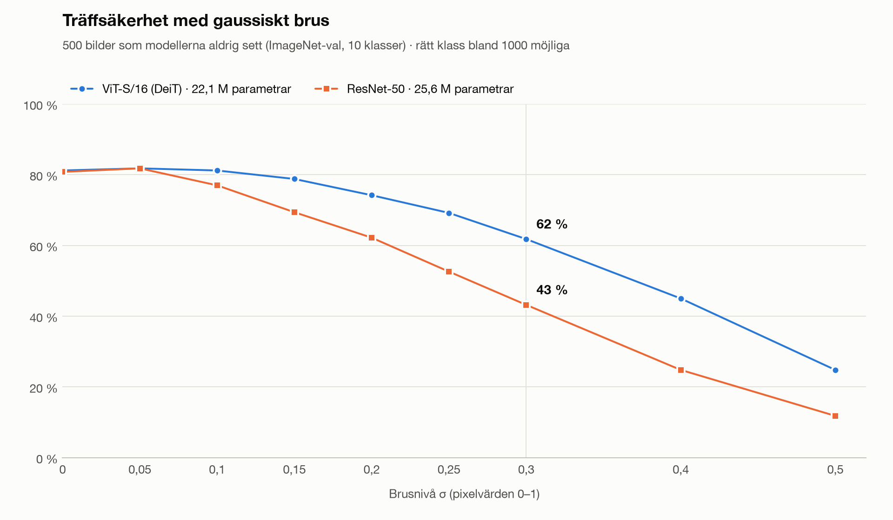
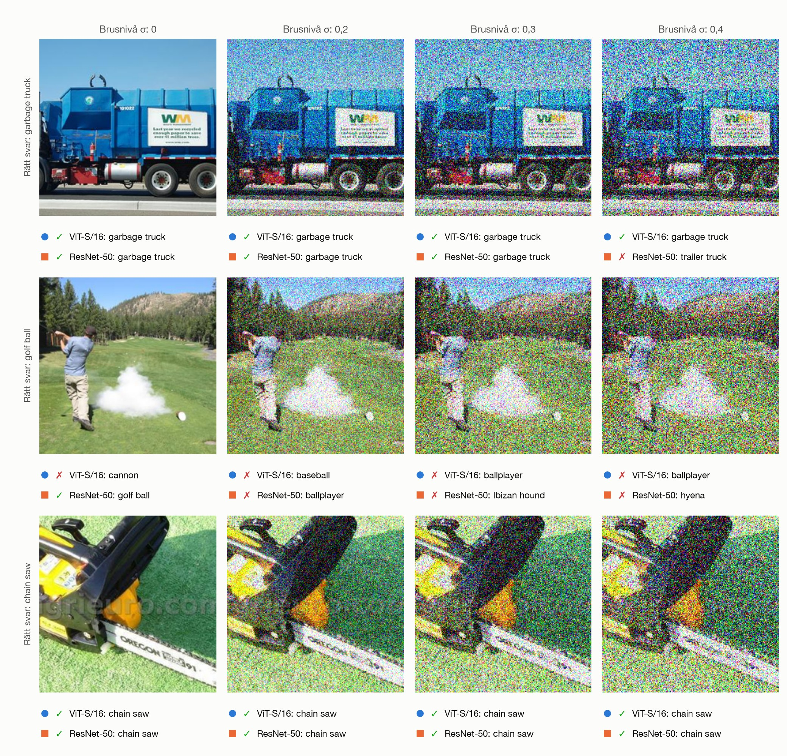
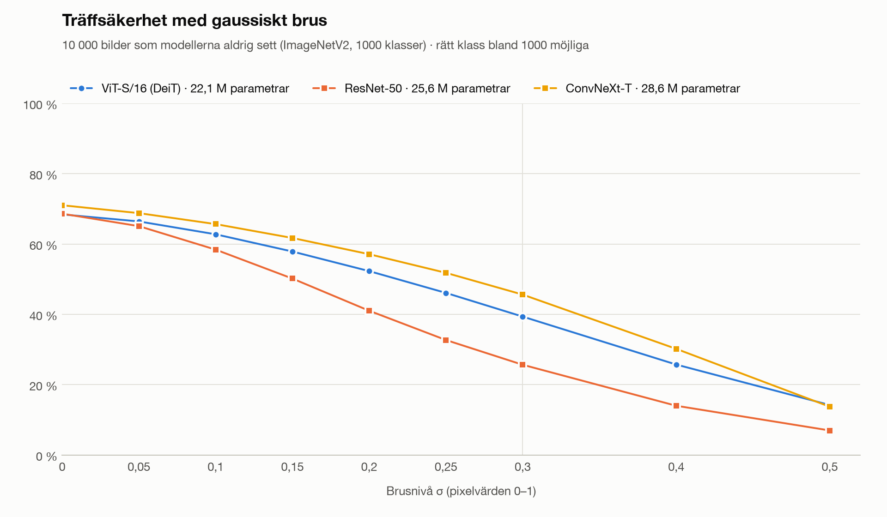
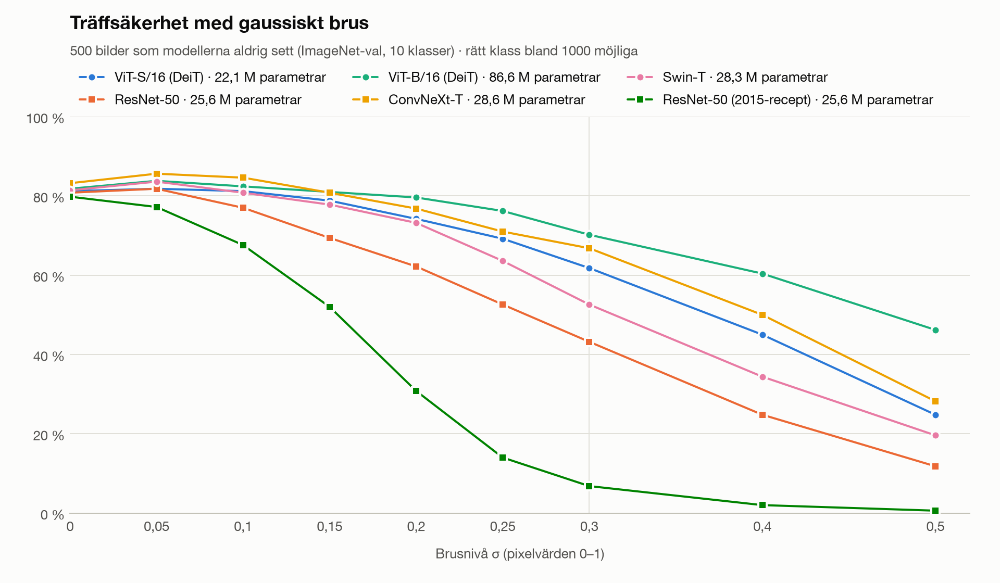

# Robustness demo: pretrained ViT vs CNN

The [CIFAR-10 experiment](experiment.md) shows the CNN winning when both models are trained from
scratch on little data. This demo shows the other side: two *pretrained* models that are equally
good on clean images are tested on images that get noisier, blurrier or more occluded. It has two
parts:

- `robustness-benchmark` measures accuracy on hundreds or thousands of unseen images and writes
  tables and slide-ready figures.
- `robustness-demo` is a browser app for the talk. Pick an image (or take one with the webcam),
  drag a slider, and watch both models' top-5 predictions change live.

## Keeping it fair

| | ViT (`vit`) | CNN (`cnn`) |
|---|---|---|
| Model | ViT-S/16, timm `deit_small_patch16_224.fb_in1k` | ResNet-50, timm `resnet50.a1_in1k` |
| Parameters | 22.1M | 25.6M |
| Training data | ImageNet-1k only (1.3M images) | ImageNet-1k only (1.3M images) |
| Training recipe | [DeiT](https://arxiv.org/abs/2012.12877): heavy augmentation, no distillation | [ResNet strikes back](https://arxiv.org/abs/2110.00476) A1: the strongest published ResNet-50 recipe |
| Accuracy on the clean test images | 81.2% | 80.8% |

Both models get exactly the same pixels: each image is resized to 256 px (bicubic), centre-cropped
to 224×224 and corrupted with the same random pattern before each model applies its own
normalisation. Accuracy is top-1 over all 1000 ImageNet classes.

`--models` accepts four more aliases for a wider comparison, all trained on ImageNet-1k only:
`vit-base` (ViT-B/16 DeiT, 86.6M), `convnext` (ConvNeXt-T, 28.6M), `swin` (Swin-T, 28.3M) and
`resnet50-2015` (the original torchvision ResNet-50 weights, trained with the simple 2015 recipe).
Any other timm model name works too.

## Test images the models never saw

[Imagenette](https://github.com/fastai/imagenette) is a 10-class subset of ImageNet that keeps
ImageNet's file names. Only 500 of its 13,394 images, those named `ILSVRC2012_val_*`, come from the
official ImageNet *validation* set; the rest come from the ImageNet *training* set, which both
models were trained on. The benchmark therefore uses just those 500 images: 50 each of tench,
English springer, cassette player, chain saw, church, French horn, garbage truck, gas pump, golf
ball and parachute.

For a check across all 1000 classes, `--dataset imagenetv2` uses
[ImageNetV2](https://github.com/modestyachts/ImageNetV2) (matched frequency): 10,000 images collected
after ImageNet, 10 per class. It is a 1.3 GB download.

## Corruptions

| Key | What it does | Severity |
|---|---|---|
| `noise` | Adds Gaussian noise to every pixel value (range 0–1) | σ from 0 to 0.5 |
| `salt-pepper` | Turns a fraction of the pixels pure black or white | fraction from 0 to 0.3 |
| `blur` | Gaussian blur | σ from 0 to 6 pixels |
| `occlusion` | Blacks out a fraction of the 16×16 squares of the ViT's own patch grid | fraction from 0 to 0.9 |
| `occlusion-shifted` | The same squares with the grid shifted 8 px, so each square cuts through four ViT patches | fraction from 0 to 0.9 |

The random pattern depends only on the image and the seed. Raising the severity strengthens the
same noise or occlusion pattern, and every model sees identical pixels.

## Running it

```bash
make download            # Imagenette (~340 MB) and the two demo models (~200 MB), once
make robustness          # ViT vs CNN, all five corruptions → results/robustness/imagenette/ (~5 min)
make robustness-models   # six models, all corruptions → results/robustness-models/ (~25 min)
make robustness-v2       # noise on ImageNetV2, ViT vs CNN vs ConvNeXt (1.3 GB download, ~15 min)
make demo                # browser demo on http://127.0.0.1:7860
```

Or call the commands directly:

```bash
uv run robustness-benchmark --perturbations noise blur --models vit cnn convnext
uv run robustness-benchmark --perturbations noise --severities 0 0.2 0.4 --dataset imagenetv2
uv run robustness-demo --models vit convnext --port 7861
```

Inference uses CUDA or Apple MPS when available, otherwise the CPU.

**Presenting offline.** Run `make download` and `make robustness` beforehand, then start the demo
with `HF_HUB_OFFLINE=1 make demo` so it never tries to reach the Hugging Face Hub. The app uses
system fonts and has Gradio's analytics switched off, so it needs no internet.

## The browser demo

- **Image:** one of ten example images (one per class, all unseen), a random unseen image, an
  upload, the webcam or the clipboard. For the example and random images the app knows the right
  answer and marks each model ✅ or ❌.
- **Corruption and slider:** the five corruptions above. The noise pattern is fixed (seed 7), so
  the slider changes its strength, not its shape.
- **Output:** the 224×224 image the models actually see, and each model's top-5 classes.
- **"Resultat på 500 osedda bilder":** the benchmark figure for the chosen corruption, if
  `make robustness` has been run.

## Output

Each benchmark run writes to `<out-dir>/<dataset>/<corruption>/`:

| File | Contents |
|---|---|
| `results.md` | Accuracy per severity and model, plus how many images only the first or only the second model got right, with an exact McNemar test |
| `results.json` | The same numbers, the model list and the run settings |
| `accuracy.png`, `accuracy-dark.png` | Accuracy against severity, light and dark versions for slides |
| `examples.jpg`, `examples-dark.jpg` | Three randomly picked images at four severities with each model's top-1 answer (skipped with `--examples 0`) |

Figures from the runs below are copied to [images/](images/).

## Results

Apple M5 Pro (MPS), October 2026, seed 0.

### ViT vs CNN on 500 unseen images

`make robustness`. "Only ViT" and "only CNN" count the images exactly one of the two models got
right; all differences below have p < 0.001 (exact McNemar test).

| Corruption | Severity | ViT-S/16 | ResNet-50 | Only ViT right | Only CNN right |
|---|---|---|---|---|---|
| None | | 81.2% | 80.8% | 20 | 18 |
| Gaussian noise | σ = 0.3 | 61.8% | 43.2% | 122 | 29 |
| Gaussian noise | σ = 0.4 | 45.0% | 24.8% | 128 | 27 |
| Salt and pepper | 5% of pixels | 72.8% | 53.4% | 111 | 14 |
| Blur | σ = 4 px | 44.0% | 33.0% | 75 | 20 |
| Occlusion on the ViT grid | 80% of squares | 50.0% | 27.2% | 131 | 17 |
| Occlusion shifted 8 px | 70% of squares | 19.0% | 41.4% | 17 | 129 |





The examples are drawn at random, not picked: in the middle row the ViT is wrong even on the clean
image.

### ImageNetV2: 10,000 images in all 1000 classes

`make robustness-v2`. Clean accuracy is about 12 points lower than on the 500 Imagenette images,
because ImageNetV2 covers all 1000 classes and is known to be harder than ImageNet's own
validation set. The ViT's advantage over ResNet-50 holds, and ConvNeXt-T stays ahead of both. "Only ViT" and "only CNN" compare ViT-S/16 with ResNet-50; every
row except the clean one has p < 0.001.

| Noise σ | ViT-S/16 | ResNet-50 | ConvNeXt-T | Only ViT right | Only CNN right |
|---|---|---|---|---|---|
| 0 | 68.4% | 68.6% | 71.0% | 644 | 664 |
| 0.2 | 52.3% | 41.0% | 57.1% | 1,692 | 565 |
| 0.3 | 39.4% | 25.7% | 45.6% | 1,856 | 486 |
| 0.4 | 25.7% | 14.0% | 30.2% | 1,551 | 379 |



### Six models on 500 unseen images

`make robustness-models`. Accuracy in percent:

| Model | Parameters | Clean | Noise σ 0.3 | Salt and pepper 10% | Blur σ 4 | Occlusion 50% on grid | Occlusion 50% shifted |
|---|---|---|---|---|---|---|---|
| ViT-S/16 (DeiT) | 22.1M | 81 | 62 | 60 | 44 | 72 | 48 |
| ViT-B/16 (DeiT) | 86.6M | 82 | 70 | 67 | 51 | 77 | 56 |
| Swin-T | 28.3M | 81 | 53 | 72 | 37 | 75 | 76 |
| ConvNeXt-T | 28.6M | 83 | 67 | 75 | 39 | 62 | 64 |
| ResNet-50, RSB A1 recipe | 25.6M | 81 | 43 | 48 | 33 | 62 | 63 |
| ResNet-50, 2015 recipe | 25.6M | 80 | 7 | 17 | 29 | 2 | 1 |



## What to take away

- **Against the classic CNN, the ViT is clearly more robust** to noise, impulse noise, blur and
  occlusion that follows its patch grid, at the same size, data and clean accuracy.
- **The ViT is fragile when a corruption cuts through its patches.** Shifting the same black
  squares by 8 px flips the result. Swin-T and ConvNeXt-T, which cut the image into 4×4 patches, see
  the shifted squares as aligned and cope well. The well-known occlusion robustness of ViTs
  ([Naseer et al. 2021](https://arxiv.org/abs/2105.10497)) depends on this alignment.
- **A modern CNN closes most of the gap.** ConvNeXt-T matches the ViT on Gaussian noise and beats it
  on impulse noise, but not on blur. It uses the three design choices that
  [Wang et al. (2023)](https://arxiv.org/abs/2206.03452) found make CNNs robust: patchified input,
  large kernels and fewer activation and normalisation layers.
- **The training recipe matters as much as the architecture.** The same ResNet-50 trained with the
  simple 2015 recipe collapses under every corruption.
- **Why the ViT handles noise well:** self-attention acts as a low-pass filter, while convolutions
  act as high-pass filters ([Park & Kim 2022](https://arxiv.org/abs/2202.06709)). Gaussian noise is
  high-frequency.

## Caveats

- The 500-image set has only 10 fairly easy classes. The ImageNetV2 run shows that the noise
  result holds across all 1000 classes; the other corruptions were only run on the 500 images.
- One seed per run. The McNemar counts show which differences are clear; a gap of a few points at
  a single severity can be noise.
- The corruptions are synthetic. Real-world shifts such as sensor noise in low light, JPEG
  artefacts or weather can behave differently.
- The two default models use different training recipes, both modern and both with heavy
  augmentation. Every model is evaluated at 224×224, although ResNet-50 A1 scores higher at its
  288×288 test size.

## Code layout

| File | Contents |
|---|---|
| [robustness/pretrained.py](../src/intro_to_vit/robustness/pretrained.py) | `ModelSpec`, `MODEL_SPECS` aliases, `Classifier` (timm model + normalisation), `load_classifiers` |
| [robustness/imagenet_data.py](../src/intro_to_vit/robustness/imagenet_data.py) | Picking the unseen Imagenette images, ImageNetV2 download, preprocessing, `ImageListDataset` |
| [robustness/perturbations.py](../src/intro_to_vit/robustness/perturbations.py) | Corruption functions and the `PERTURBATIONS` registry with sweeps and slider settings |
| [robustness/benchmark.py](../src/intro_to_vit/robustness/benchmark.py) | Evaluation loop, paired comparison, exact McNemar test |
| [robustness/report.py](../src/intro_to_vit/robustness/report.py) | `results.json` and `results.md` |
| [robustness/plots.py](../src/intro_to_vit/robustness/plots.py) | Accuracy curves and the example grid, in light and dark |
| [robustness/app.py](../src/intro_to_vit/robustness/app.py) | The Gradio browser demo |
| [robustness/cli.py](../src/intro_to_vit/robustness/cli.py) | `robustness-benchmark`, `robustness-demo` and `robustness-download` |
