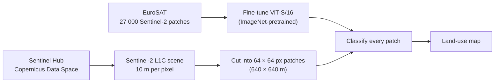
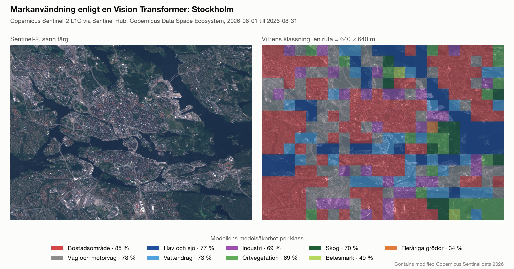

# Satellite demo: a ViT maps land use in Copernicus Sentinel-2 images

This example uses only a Vision Transformer. It fine-tunes a pretrained ViT on EuroSAT, a dataset
of Copernicus Sentinel-2 image patches, and then uses it to draw a land-use map of a fresh
Sentinel-2 scene that it fetches through Sentinel Hub on the Copernicus Data Space Ecosystem.



## Quick start

```bash
make satellite-train                  # fine-tune the ViT on EuroSAT (~8 min, once)
make satellite-demo                   # fetch Stockholm via Sentinel Hub and draw the map
make satellite-demo AREA=uppsala      # or: lund
```

The map lands in `results/satellite/<area>/map.png`, with each class's share and mean confidence in
`summary.md` and every patch's class and confidence in `land_use.json`.

Other areas and dates:

```bash
uv run satellite-fetch --bbox 11.90 57.66 12.10 57.74 --start 2026-05-01 --end 2026-09-30
uv run satellite-map --bbox 11.90 57.66 12.10 57.74
```

## Sentinel Hub credentials

Sentinel-2 data on the Copernicus Data Space Ecosystem is free, but the Sentinel Hub API needs an
account and an OAuth client:

1. Register at [dataspace.copernicus.eu](https://dataspace.copernicus.eu).
2. Open the [Sentinel Hub dashboard](https://shapps.dataspace.copernicus.eu/dashboard/#/account/settings),
   find "OAuth clients" under User settings and click "Create". Copy the client id and the
   secret; the secret is shown only once.
3. Copy `.env.example` to `.env` in the repository root and fill in the two values. `.env` is
   git-ignored, and the code reads it automatically:

   ```bash
   SH_CLIENT_ID=<client id>
   SH_CLIENT_SECRET=<client secret>
   SH_PROVIDER=cdse
   ```

   Variables already set in the shell take precedence over `.env`. sentinelhub's own config file
   works too: `uv run sentinelhub.config --sh_client_id <client id> --sh_client_secret <client secret>`.

`SH_PROVIDER` picks the deployment: `cdse` (default) is the free Copernicus Data Space Ecosystem at
`https://sh.dataspace.copernicus.eu`, and `sentinelhub` is the commercial services.sentinel-hub.com.
`SH_BASE_URL` and `SH_TOKEN_URL` override the endpoints. A free Copernicus account includes 10,000 processing units and 10,000 requests a
month ([quotas](https://documentation.dataspace.copernicus.eu/Quotas.html)); one scene for this demo
uses fewer than ten units. Without credentials, `satellite-fetch` stops with these instructions.

## How it works

**Training data.** [EuroSAT](https://github.com/phelber/EuroSAT) ([paper](https://arxiv.org/abs/1709.00029)) has 27,000 RGB patches of 64 × 64
pixels at 10 m per pixel, cut from Copernicus Sentinel-2 L1C images of 34 European countries and
labelled with ten classes: annual crop, forest, herbaceous vegetation, highway, industrial,
pasture, permanent crop, residential, river and sea/lake. torchvision downloads it (94 MB) on first
use.

**The model.** ViT-S/16 (`deit_small_patch16_224.fb_in1k` in timm, 22M parameters), pretrained on
ImageNet photos, gets a new ten-class head and is fine-tuned for three epochs on 80% of EuroSAT
(AdamW, learning rate 1e-4, warm-up and cosine decay, label smoothing). Patches are upscaled from 64
to 224 pixels so each 16 × 16 ViT patch sees about 4.6 × 4.6 Sentinel-2 pixels. Training adds random
flips, 90-degree rotations (satellite images have no "up") and mild brightness and contrast jitter.
The other 20% is held out for validation, with the same class mix.

**Matching the training data.** EuroSAT's RGB images are Sentinel-2 L1C reflectance × 10000 / 2750,
clipped to 8 bits. The repo checked this from the data: the mean of each EuroSAT RGB channel is the
mean of the matching EuroSAT band divided by 2703–2752. The Sentinel Hub request therefore asks for
the L1C collection and applies exactly that gain in its evalscript, so a new scene looks to the ViT
like its training data:

```js
//VERSION=3
function setup() {
  return {
    input: [{ bands: ["B02", "B03", "B04"], units: "REFLECTANCE" }],
    output: { bands: 3, sampleType: "AUTO" }
  };
}
function evaluatePixel(sample) {
  const gain = 3.636364;  // 10000 / 2750
  return [gain * sample.B04, gain * sample.B03, gain * sample.B02];
}
```

**The scene.** The request covers the area's bounding box in its UTM zone, so pixels are exactly
10 × 10 m like EuroSAT's, uses the least cloudy data in the date range (`leastCC` mosaicking,
at most 20% cloud cover per tile by default) and returns a PNG. One Process API request returns at
most 2500 × 2500 pixels, which is 25 × 25 km at 10 m; the three predefined areas are 11–16 km wide.

**The map.** The scene is cut into non-overlapping 64 × 64 pixel patches (640 × 640 m), each is
classified, and patches without data are skipped. The map shows each patch in its class colour on
top of the image. The legend gives the model's mean confidence for each class, the average
probability it gave its prediction on the patches of that class, with the most common class first.

## Results

Apple M5 Pro (MPS), October 2026, seed 0.

**EuroSAT.** After three epochs (about 160 s each) the ViT classifies 99.0% of the 5,400 held-out
patches correctly; every class is between 97.5% (pasture) and 99.8% (residential).

| Epoch | Validation accuracy |
|---|---|
| 1 | 97.6% |
| 2 | 98.7% |
| 3 | 99.0% |

**A real scene.** The map below is Stockholm, fetched through Sentinel Hub on the Copernicus Data
Space Ecosystem with `make satellite-demo` (least cloudy data from summer 2026).



- **Recognised:** the inner city and suburbs as residential, the Värtahamnen port as industrial,
  Saltsjön and Lake Mälaren as sea/lake, and the green of Djurgården as forest and herbaceous
  vegetation.
- **Narrow straits become "river".** EuroSAT has no class for a strait, so the channels between
  the islands take the closest class.
- **Over-predicted:** "highway" takes 19% of the patches. In a city most 640 m patches mix houses,
  roads and green space, while EuroSAT's patches were chosen to show one class each. The model
  falls back on "highway" for many of these mixed patches.

The scaling was checked against an independent source: for Uppsala, the scene Sentinel Hub returned
is pixel-identical to the same Sentinel-2 L1C acquisition (14 July 2026) read from Google Cloud's
public copy and scaled by hand.

## Limitations

- **Coarse.** One label per 640 × 640 m patch. For finer maps, segmentation models such as Prithvi
  or a DINOv3 backbone with a segmentation head are the next step.
- **Ten European classes.** There is no class for wetland, bare rock, snow, airports or ports;
  such areas get the closest class.
- **Domain shift.** EuroSAT was published in 2017, so its images are older. Sentinel Hub harmonises
  newer L1C data to the old value range, but seasons, haze and thin cloud still change the picture.
- **One scene per area.** `leastCC` mosaicking can combine tiles from different days when an area
  spans two Sentinel-2 tiles.

## Licences and attribution

Sentinel-2 data is free and open under the Copernicus licence; maps carry the required line
"Contains modified Copernicus Sentinel data <year>". EuroSAT is released under the MIT licence.

## Code layout

| File | Contents |
|---|---|
| [satellite/eurosat.py](../src/intro_to_vit/satellite/eurosat.py) | EuroSAT loading, stratified split, transforms, the EuroSAT gain, class names and colours |
| [satellite/model.py](../src/intro_to_vit/satellite/model.py) | The ViT, saving and loading the fine-tuned checkpoint |
| [satellite/train.py](../src/intro_to_vit/satellite/train.py) | Fine-tuning and per-class validation accuracy |
| [satellite/sentinel.py](../src/intro_to_vit/satellite/sentinel.py) | Copernicus Data Space config, the evalscript, predefined areas, the Process API request |
| [satellite/mapping.py](../src/intro_to_vit/satellite/mapping.py) | Cutting the scene into patches, classifying them, the map and the summary |
| [satellite/cli.py](../src/intro_to_vit/satellite/cli.py) | `satellite-train`, `satellite-fetch` and `satellite-map` |
